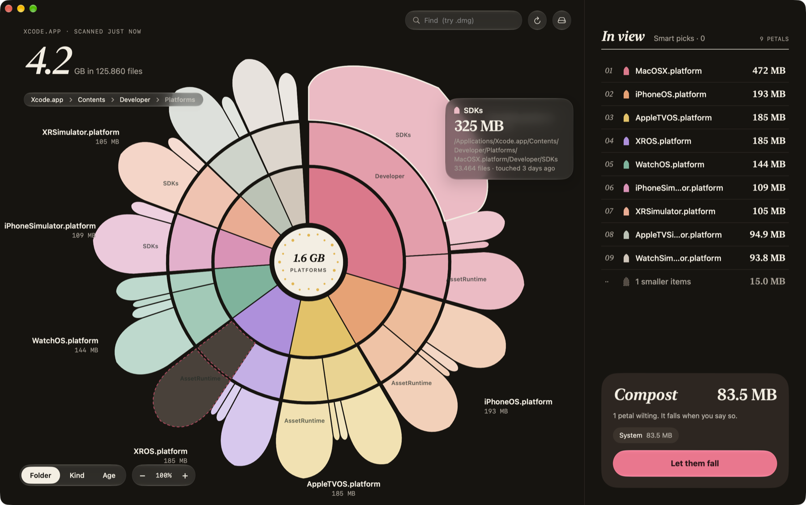

# OpenLily

An open-source disk space visualizer for macOS, in the spirit of DaisyDisk, drawn as a lily.

Every folder is a ring segment sized by what it holds on disk. Folders nest outward, and wherever a branch ends it curves into a petal tip.



## How it's different from DaisyDisk

DaisyDisk is a lovely app, and OpenLily borrows its best idea: a ring you click into, plus a bin you fill before deleting. Here's what OpenLily does differently:

- **Free and open source.** MIT licensed. Read the scanner, change the rules, ship a fork.
- **A map, not just a menu.** You can open folders by clicking, but you can also pinch-zoom and pan freely like a map. Deeper levels fade in as you zoom, and the sidebar lists only what's currently on screen.
- **It tells you what's safe to delete.** Smart picks find things that rebuild themselves, like Xcode DerivedData, `node_modules`, build folders and caches, and say why each is safe. Things that deserve a second look, like old installers and huge files you haven't opened in a year, are flagged separately. One click bins every safe pick.
- **Find, then bin.** Type `.dmg` or a name, everything else dims, and "Compost all" bins every match.
- **More ways to see it.** Color the ring by folder, by file kind (video, images, code…) or by age, to spot what you haven't touched in years.
- **Nothing is final straight away.** Deleting moves things to the Trash, with Undo. The countdown before deleting can be cancelled, and macOS system folders can't be binned at all.

Not there yet: live updates while files change, duplicate finding, and notarization. Releases are ad-hoc signed, so macOS asks you to confirm once before the first launch.

## Install

Needs macOS 27 on an Apple silicon Mac.

1. Download `OpenLily-<version>.dmg` from [Releases](../../releases), open it, and drag OpenLily into Applications.
2. Releases are ad-hoc signed rather than notarized by Apple, so the first launch is blocked with "Apple could not verify…". Click **Done**, then open **System Settings → Privacy & Security**, scroll down, and click **Open Anyway** next to OpenLily. You only have to do this once.

   Or, from Terminal:

   ```bash
   xattr -dr com.apple.quarantine /Applications/OpenLily.app
   ```

3. Optional but recommended: give it **Full Disk Access** (the start screen links there). Without it, macOS hides Mail, Messages, Safari data and similar folders from the scan, and asks about Desktop, Documents and Downloads one by one.

`SHA256SUMS.txt` in each release lets you check your download with `shasum -a 256 -c SHA256SUMS.txt`.

## What it does

- **Fast parallel scan.** Uses `getattrlistbulk(2)` on a pool of worker threads. Counts allocated blocks (like `du`) and counts hard links once. Scanning `/` follows the APFS firmlinks into the Data volume without counting anything twice. Space the volume reports as used but the scan couldn't see shows up as **Hidden space**.
- **Zoom & pan, not just drill-down.** Pinch, ⌘-scroll or mouse wheel to zoom around the cursor. Two-finger scroll or drag empty space to pan. Deeper rings fade in as you zoom, and each ring is thinner than the one inside it, so the lily never runs out of room.
- **No hairlines.** Anything too thin to read on screen is folded into one soft "+N smaller items" petal at the end of its folder. Hover it to see what's inside; click it to zoom in or open the folder.
- **Click to open a folder.** The ring re-blooms around it. Click the center (or press Esc) to go back up, or use the breadcrumbs.
- **"In view" sidebar.** Lists what is actually on screen for the current zoom and pan. If only one folder is in view, it lists that folder's contents instead.
- **Smart picks.** Flags space you can safely get back and says why: Xcode DerivedData and DeviceSupport, `node_modules`, SwiftPM `.build`, Cargo `target`, Pods, app caches, package-manager caches and the Trash. Things that need a look first are flagged separately: old installers in Downloads, big files untouched for a year, simulators, device backups, Docker. "Compost everything that rebuilds itself" bins all the safe picks in one click.
- **Color by Folder, Kind or Age.**
- **Find.** Type to dim everything except matches; `.dmg` matches by extension. Then "Compost all" the results.
- **Compost.** Drag petals from the ring or rows from the sidebar into the bin. They wilt in place (dashed outline) until you press **Let them fall**: a 3‑2‑1 countdown you can cancel, then the petals burst off the ring and the ring closes over the gap. Items go to the **Trash**, and Undo puts them back. Undo needs Full Disk Access; without it, use Put Back in Finder.
- Quick Look (space), Reveal in Finder, right-click menus, ⌘F, ⌘R rescan, ⌘O scan a folder, dark mode, and Liquid Glass controls.

## Building

Open `OpenLily.xcodeproj` in Xcode 27 and run. Targets macOS 27.

The app is deliberately **not sandboxed**: a disk scanner has to see the whole disk. Without Full Disk Access, macOS still hides Mail, Messages, Safari data and similar folders from it.

To make a release like the ones on the Releases page (Release configuration, ad-hoc signed, packaged as a `.dmg` and `.zip` with checksums in `dist/`):

```bash
./scripts/build-release.sh
```

Dev shortcut (Debug builds only): set `OPENLILY_SCAN=/some/path` to skip the start screen and scan that path straight away. In Xcode, add it under Product → Scheme → Edit Scheme → Run → Environment Variables. From the command line:

```bash
xcodebuild -scheme OpenLily -derivedDataPath build/DerivedData build
open --env OPENLILY_SCAN=$HOME/Projects build/DerivedData/Build/Products/Debug/OpenLily.app
```

## Layout

The app's source and icon live in `OpenLily/`. The release script is `scripts/build-release.sh`.

| File | What's in it |
| --- | --- |
| `Scanner.swift` | Parallel `getattrlistbulk` walker and bottom-up totals |
| `FileNode.swift` | Tree node and file-kind table |
| `Smart.swift` | Smart-pick rules and search |
| `Ring.swift` | Lily geometry, camera, color painter |
| `RingCanvas.swift` | Canvas renderer with animated focus and wilt transitions |
| `RingInteraction.swift` | AppKit layer for trackpad, mouse and keys |
| `AppModel.swift` | App state: scanning, navigation, compost, trash and undo |
| `RingStage.swift`, `Sidebar.swift`, `Compost.swift`, `StartView.swift`, `ScanningView.swift` | Views |
| `AppIcon.icon` | The Liquid Glass app icon (open it in Icon Composer) |

## License

MIT. See [LICENSE](LICENSE).
